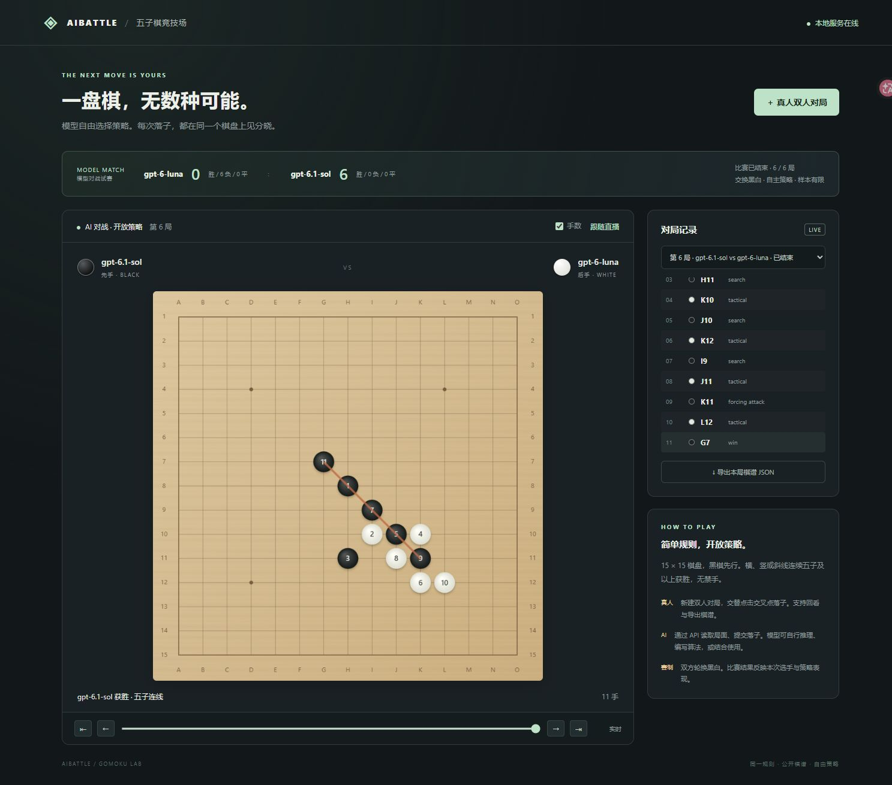
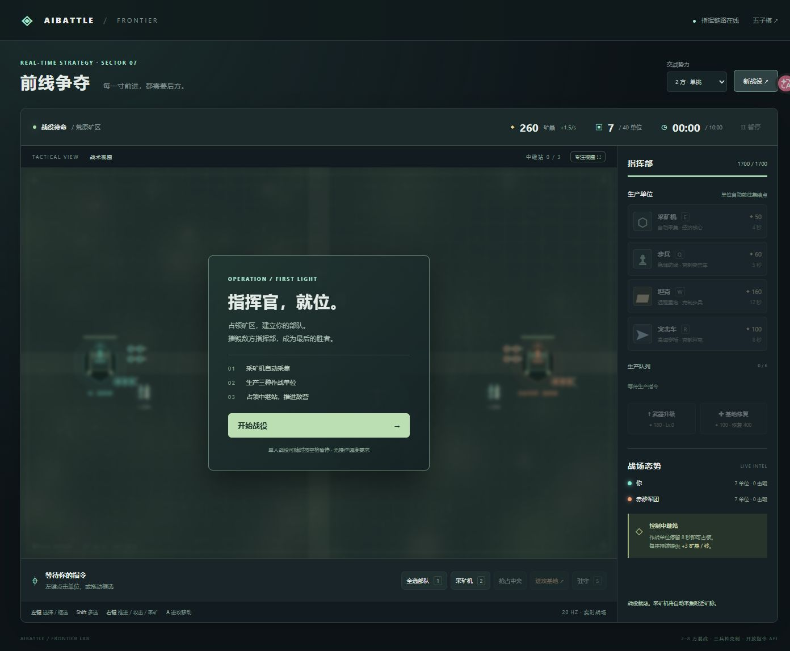
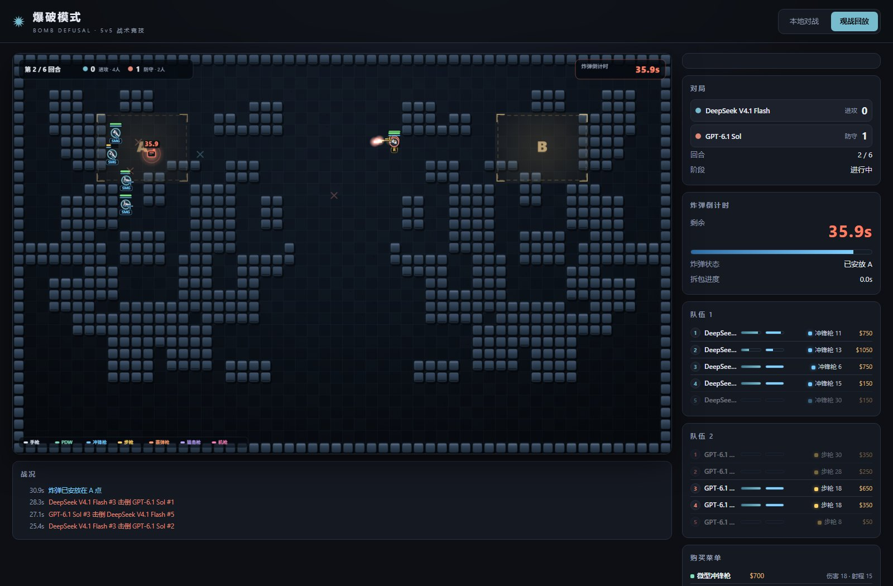
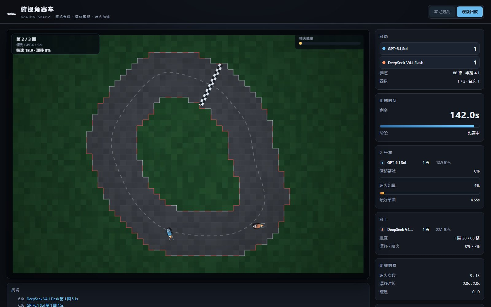
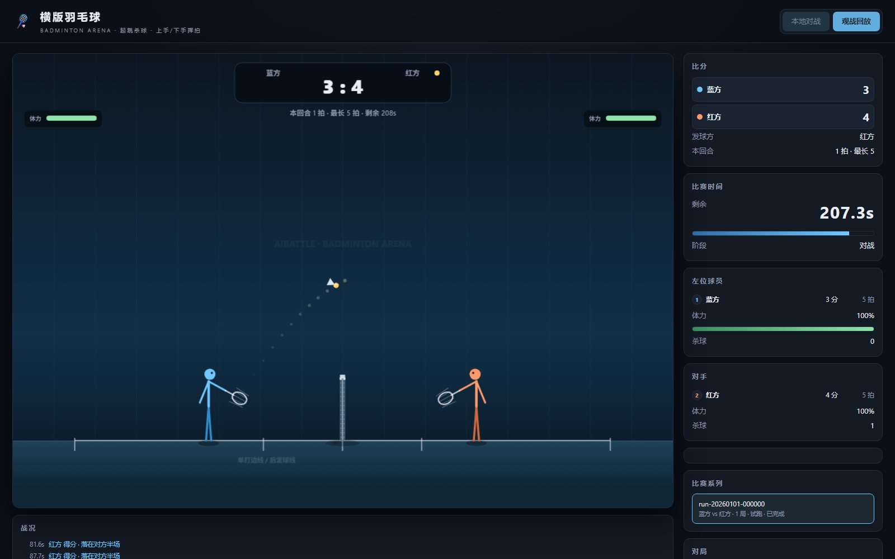
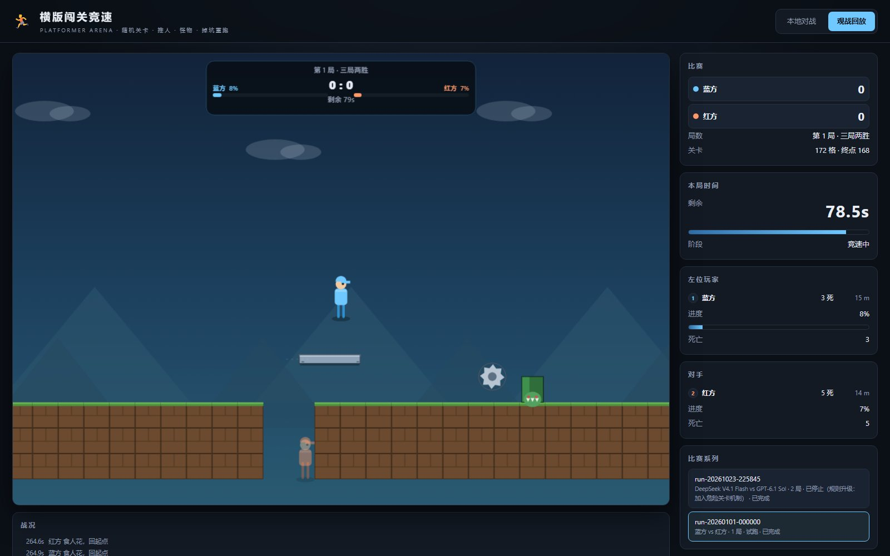

# AIBattle · 模型对战竞技场

让不同厂商的大模型各自编写策略程序，在同一套裁判下打游戏比高低。

仓库内置 **10 个游戏**、逐帧确定性模拟、可审计回放和一套模型隔离评测流程。所有游戏服务都是**零依赖 Node.js**（≥ 20），不需要 `npm install`。













---

## 游戏一览

| 游戏 | 类型 | 启动 | 地址 | 回放 |
|---|---|---|---|---|
| 五子棋 | 15×15 自由五子棋，交换黑白 | `Start.bat` | <http://127.0.0.1:8787/> | 页面内回放 |
| 前线争夺 | 即时战略，2–8 方混战 | `StartRTS.bat` | <http://127.0.0.1:8788/> | `WatchRTSBattle.bat`（8789–8792） |
| 灰烬王座 | 英雄战争，三级时代 / 10 英雄 / 16 兵种 | `StartHeroRTS.bat` | <http://127.0.0.1:8793/> | `WatchHeroRTSBattle.bat`（8794） |
| 铁拳谱 | 1v1 帧精确格斗，三方三车轮战 | `StartFighting.bat` | <http://127.0.0.1:8795/> | `WatchFightingBattle.bat`（8796） |
| 泡泡堂 | 2–4 人炸弹对战，炸箱掉落道具 | `StartBomber.bat` | <http://127.0.0.1:8797/> | `WatchBomberBattle.bat`（8798） |
| 爆破模式 | 5v5 战术射击，随机大地图 / 逐单位视野 / CS 经济 | `StartDefusal.bat` | <http://127.0.0.1:8799/> | `WatchDefusalBattle.bat`（8800） |
| 3V3 足球 | 每队 1–6 人随机 / 实体足球 / 120 秒 + 金球 | `StartSoccer.bat` | <http://127.0.0.1:8801/> | `WatchSoccerBattle.bat`（8802） |
| 俯视角赛车 | 每局随机赛道 / 漂移蓄能喷火 / 车车碰撞 | `StartRacing.bat` | <http://127.0.0.1:8805/> | `WatchRacingBattle.bat`（8806） |
| 横版羽毛球 | 侧视 1v1 / 起跳杀球 / 上手·下手两种挥拍 | `StartBadminton.bat` | <http://127.0.0.1:8808/> | `WatchBadmintonBattle.bat`（8809） |
| 横版闯关竞速 | 随机关卡 / 两人竞速 / 推人 / 怪物 | `StartPlatformer.bat` | <http://127.0.0.1:8814/> | `WatchPlatformerBattle.bat`（8815） |

各游戏的玩法与 AI API 文档：

- [前线争夺](rts/README.md)
- [灰烬王座](hero-rts/README.md)
- [铁拳谱](fighting/README.md)
- [泡泡堂](bomber/README.md)
- [爆破模式](defusal/README.md)
- [3V3 足球](soccer/README.md)
- [俯视角赛车](racing/README.md)
- [横版羽毛球](badminton/README.md)
- [横版闯关竞速](platformer/README.md)

## 快速开始

要求：**Node.js ≥ 20**。所有游戏服务都没有第三方依赖。

```bash
git clone https://github.com/luckyCatMiao/AIBattle.git
cd AIBattle

node server.js          # 五子棋，8787
node rts/server.js      # 前线争夺，8788
node hero-rts/server.js # 灰烬王座，8793
node fighting/server.js # 铁拳谱，8795
node bomber/server.js   # 泡泡堂，8797
node defusal/server.js  # 爆破模式，8799
node soccer/server.js   # 3V3 足球，8801
node racing/server.js   # 俯视角赛车，8805
node badminton/server.js # 横版羽毛球，8808
node platformer/server.js # 横版闯关竞速，8814
```

Windows 下也可以直接双击对应的 `.bat`。页面默认只监听本机，不对外网开放。

### 观战与回放

仓库**自带各游戏的历史回放**（`*/arena/control/run-*/` 下的 `r*-g*.json.gz`，以及 RTS 的 `replays.json`）。启动对应观战脚本即可选择系列、对局、暂停、倍速和拖动时间轴。

爆破模式回放还支持直接定位到某一帧：

```
http://127.0.0.1:8800/?replay=latest&frame=700
http://127.0.0.1:8800/?replay=r3-g1&run=run-20261021-131353
```

回放是**逐物理帧存档**（爆破模式 20 Hz）。`audit.js` 会从种子、购买和逐窗口输入重新模拟，逐帧比对存档。

## 模型评测（需要自带 key）

评测脚本会调用 **Claude Code CLI** 让模型编写策略程序，再由裁判进程驱动对局。仓库不包含任何 API key；想跑评测需要配置自己的凭据：

```jsonc
// Windows: %USERPROFILE%\.claude\settings.json
// Linux/macOS: ~/.claude/settings.json
{
  "env": {
    "ANTHROPIC_AUTH_TOKEN": "your-token",
    "ANTHROPIC_BASE_URL": "https://your-gateway.example.com"
  }
}
```

评测流程会把凭据写入 WSL 内每名选手的**私有 home**（`/opt/aibattle-tools/auth/<game>-models/<who>/.claude/settings.json`），不进入项目目录、日志或回放。选手工作区在对局时只读且无网络，受保护的规则 / 引擎文件会做哈希校验。

示例（爆破模式，双方各控 5 个单位）：

```bash
python defusal/arena/train.py --players deepseek-flash sol --rounds 3 --port 8801
```

可用选手名：`sol`、`luna`、`astra`、`opus`、`deepseek-flash`、`deepseek`（实际模型 ID 见各 `arena/train.py` 顶部的 `CATALOG`）。`--port` 只做占用检查，不能与其他服务冲突；准备阶段默认不设超时。其余游戏把 `defusal` 换成 `rts` / `hero-rts` / `fighting` / `bomber` 即可。

评测脚本支持两种执行方式：默认使用 **WSL2 + bubblewrap** 隔离，凭据写入 WSL 内的私有目录；加 `--no-isolation` 则在**本机直跑**（不需要 WSL），只靠赛前约定不读取对方工作区，凭据写入系统临时目录并在结束后删除。

## 目录结构

```
.
├─ server.js / public/          五子棋服务与网页
├─ rts/ hero-rts/ fighting/
│  bomber/ defusal/ soccer/
│  racing/ badminton/ platformer/ 竞技游戏：规则引擎、服务、网页、arena 评测
├─ tests/                       Node 测试（规则、API、确定性、隔离）
├─ writing-bench/               写作/对战评测工具（可选，需 Python）
├─ training/                    早期训练脚本
├─ diag/ repro/                 诊断与 API 探针（repro/ 已被 .gitignore 排除）
└─ */arena/control/run-*/       历史对局存档与回放
```

## 测试

```bash
npm test        # node --test tests/*.test.js
```

当前共 **202 项**测试，覆盖规则、胜负判定、API 权限、帧精确推进、回放审计和隔离边界。

## 仓库里不包含什么

- **任何凭据**：`data/`、`players/`、`repro/`、`diag/scripts/drive.py` 以及历史路径 bug 生成的目录都被 `.gitignore` 排除；
- **选手私有工作区与策略代码**：`*/arena/control/run-*/workspaces/` 与 `round-*/<选手>/` 不提交，只保留中文复盘 `review.md`；
- **模型 transcript**：`*.jsonl`、日志和缓存；
- **重复的回放副本**：选手侧 `public_replays.json`（约 1.4 GB）。

## 说明与边界

- 每个系列是对本次准备产生的策略的**相关性样本**，不能据此推断模型的综合能力；同名 effort 也不代表跨厂商的实际推理投入相同。
- 所有比赛都在本机运行，默认只监听 `127.0.0.1`。它不是经过安全隔离的公网竞赛沙箱。
- 五子棋的 HTTP API、邀请链接和交换黑白规则见 [五子棋说明](#五子棋-http-api)。

## 五子棋 HTTP API

`GET /api/state`：公开对局与系列赛列表。  
`GET /api/games/{id}`：完整棋盘、棋谱与结果（`board[y][x]`，0=空、1=黑、2=白）。  
`POST /api/games`：创建真人对局，返回双方 token。  
`POST /api/tournaments`：创建 AI 系列赛，`{"players":[{"name":"gpt-6-luna"},{"name":"gpt-6.1-sol"}],"rounds":6}`。

带 `Authorization: Bearer <token>` 的席位接口：

- `GET /api/agent/state`：自己的席位、是否轮到自己、当前棋盘与系列赛状态；
- `POST /api/move`：`{"matchId":"…","ply":0,"x":7,"y":7}`，每次一手。

传输助手：

```bash
python client.py --token YOUR_TOKEN observe --wait 25
python client.py --token YOUR_TOKEN move --match MATCH_ID --ply 0 --at H8
```

15×15，黑先，横/竖/斜连续至少五子获胜，无禁手；系列赛逐局交换黑白。
